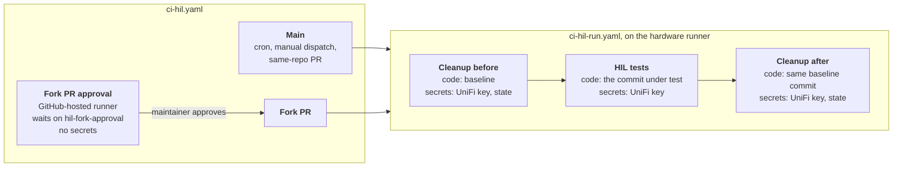
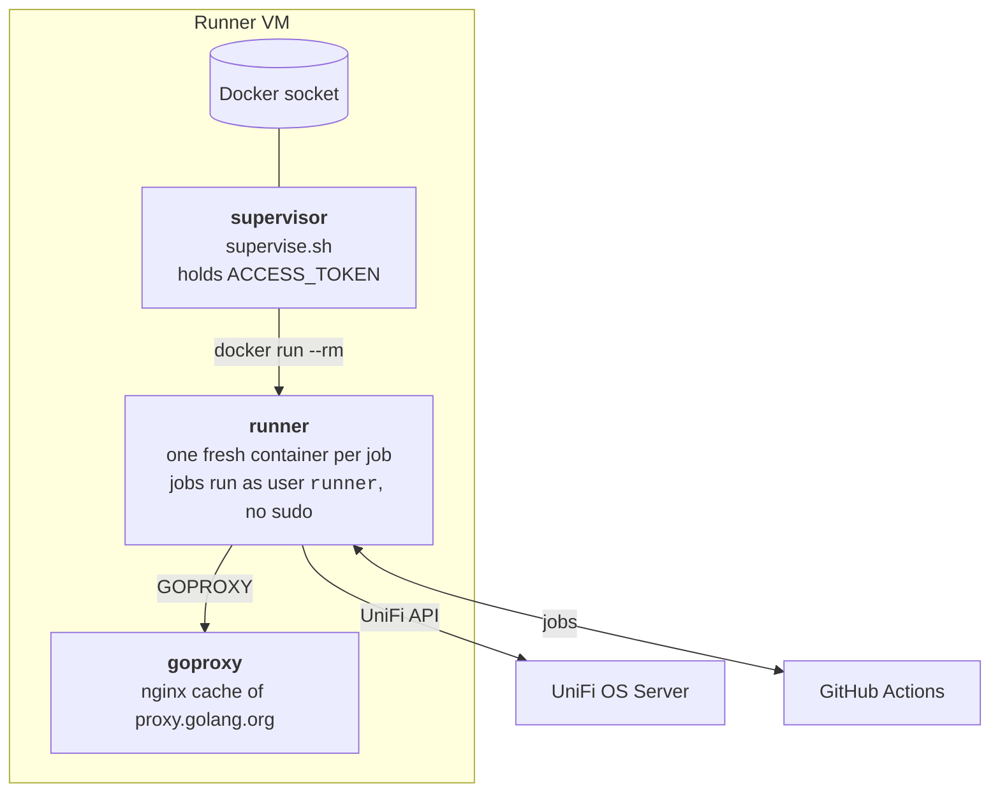

# HIL Security Model

The hardware-in-the-loop (HIL) tests run code from pull requests on a self-hosted GitHub Actions runner.
That runner lives on a home lab network and holds credentials for a real UniFi controller.
This document describes what needs protecting, which code can run on the runner, the controls that limit it, and the gaps that remain.

Read this before approving a fork PR's HIL run, changing the HIL workflows, or changing the runner.

## What Needs Protecting

| Asset | Where it lives | Impact if exposed |
|---|---|---|
| UniFi API key | Repository secret `TERRIFI_HIL_TEST_UNIFI_API_KEY` | Admin access to the HIL test controller |
| Terraform state credentials | Repository secrets `TERRIFI_HIL_STATE_*` | Read or corrupt the HIL baseline state in a private R2 bucket. The state describes the controller's configuration. |
| Heartbeat URL | Repository secret `TERRIFI_HIL_HEARTBEAT_URL` | Someone could fake or suppress the nightly heartbeat |
| Runner registration token | `.env` on the runner VM, as `ACCESS_TOKEN` | Admin access to this repository, including settings and deletion |
| Runner VM and HIL network | A Proxmox VM on the HIL network | A foothold for reaching the controller, the HIL network, and the VM's tailnet |

## Which Code Runs on the Runner

| Trigger | Code that runs | Approval |
|---|---|---|
| Nightly cron | `main` | None |
| Manual dispatch | The selected branch | None, requires write access |
| PR from a branch in this repository | The PR head commit | None, requires write access |
| PR from a fork | The PR head commit | Required, per push |
| Device-types site deploy (`deploy-site.yaml`), on a push to `main` that touches the site, or on manual dispatch | `main`, or the selected branch | None, requires write access |

PR events run only when the PR diff touches Go source, `go.mod`, `go.sum`, or `.github/workflows/`. A docs-only fork PR never reaches the approval gate.

Fork PRs also trigger the `pull_request` event. The workflow skips that path, because GitHub withholds secrets from it.

Dependabot PRs run on the same-repository path. GitHub gives Dependabot-triggered runs only Dependabot secrets. The HIL job therefore fails at the connection check, unless the UniFi key is also stored as a Dependabot secret.

## How a Run Works

[`ci-hil.yaml`](../.github/workflows/ci-hil.yaml) decides who may run and routes every event to the reusable [`ci-hil-run.yaml`](../.github/workflows/ci-hil-run.yaml), which does the work in three jobs on the hardware runner. Each job gets a fresh runner container (see [Runner Hardening](#runner-hardening)).



- **Cleanup before** checks out the baseline, builds the Terrifi CLI from it, and runs `terrifi-tests reset`. That restores the [Terraform baseline](./terraform/) from the R2 state and deletes any extra resources left on the controller. For same-repository runs the baseline is the commit under test, so baseline changes can be tested. For fork runs it is always `main`.
- **HIL tests** checks out the commit under test and runs the acceptance tests against the controller. This is the only job that runs PR code. It receives the UniFi key and nothing else.
- **Cleanup after** repeats the reset, pinned to the same baseline commit as the first cleanup. It runs after test failures and cancellations too, but only if the first cleanup succeeded.

The `Main` and `Fork PR` jobs share the `terrifi-hil-hardware` concurrency group, which serializes whole runs. Nothing else touches the controller between the cleanups. A fork run joins the group only after approval, so a run waiting for a maintainer never holds the hardware.

## Fork PR Flow

Fork PRs go through `pull_request_target`.

1. Opening, reopening, or pushing to a fork PR starts a run. GitHub always loads `pull_request_target` workflows from `main`, so the PR cannot change the workflow, the approval gate, which secrets are passed, or the reset code.
2. The `Fork PR approval` job runs on a GitHub-hosted runner and waits on the `hil-fork-approval` environment. It holds no secrets.
3. A maintainer reviews the PR and approves the deployment. The job logs the PR number, fork repository, and head commit SHA.
4. The run enters the hardware queue. Cleanup resets the controller using `main`, the tests job checks out the approved SHA and runs it with the UniFi key, and cleanup resets the controller again. The result appears as a check on the PR.
5. A new push to the PR cancels the older run, whether it is waiting for approval or already running. The new run needs its own approval.

Other controls on this path:

- **Read-only token:** the workflow sets `permissions: contents: read`. By default, `pull_request_target` would grant a write token.
- **No stored git credentials:** checkout uses `persist-credentials: false`.
- **Explicit opt-in to fork checkout:** `actions/checkout` refuses fork code under `pull_request_target` unless `allow-unsafe-pr-checkout` is set. Only the fork path sets it, and only after approval.
- **Minimal secrets:** the tests job receives the UniFi key. Fork runs never receive the heartbeat URL, and the state credentials go only to the reset step of the cleanup jobs, which never run fork code.
- **No Actions caches:** the HIL jobs use no cache actions. Go, Task, and OpenTofu come from the runner image, so fork code cannot write a cache that a trusted run restores.

### Two Separate Approvals

A fork PR asks the maintainer for two different approvals:

1. **Workflow approval**, shown as a banner on the PR. The repository requires approval for every external contributor before `pull_request` workflows run, for example the Docker-based tests in `CI - Local`. These run fork code on GitHub-hosted runners, with no secrets and a read-only token. This approval does not apply to `pull_request_target`, so it does not gate the HIL run.
2. **Deployment approval** for the `hil-fork-approval` environment, shown on the HIL run itself. This is the gate for the hardware runner.

Approving the first does not approve the second.

### Before Approving a Fork Run

Approving lets the PR's code run on the runner as the `runner` user, with the UniFi key and network access to the HIL controller. Only approve code you have read.

1. Open the waiting run. Confirm that the head SHA matches the commit you reviewed.
2. Read the whole diff at that commit. Pay extra attention to anything that executes during the build or tests:
   - Go code, including `init()` functions, `TestMain`, and test helpers.
   - `go.mod` and `go.sum` changes, which can pull in new code.
   - `Taskfile.yml`, shell scripts, and anything under `cmd/terrifi-tests`.
   - Changes under `.github/` and `hardware-testing/terraform/` do not take effect for fork runs, because the workflow and the baseline come from `main`. Still review them in case the PR is merged.
3. Approve with **Review deployments**. Do not use **Start all waiting jobs**, which is the administrator bypass rather than a review.

## Runner Hardening

The runner is defined in [`github-runner/`](./github-runner/). It is three Compose services on the runner VM.



- **One fresh container per job:** the runner is ephemeral and exits after a single job. The supervisor then deletes its container with `docker run --rm` and starts a new one from the image. Nothing a job writes, such as Go caches or files under `/home/runner`, reaches the next job. A Docker restart policy would have reused the old container's filesystem.
- **Docker socket only for the supervisor:** the socket is equivalent to root on the runner VM. The supervisor runs nothing but `supervise.sh`, exposes no ports, and is not on the runner's network. Job containers never get the socket. HIL tests do not need Docker; Docker-based tests run on GitHub-hosted runners.
- **Non-root jobs without sudo:** the container's first process keeps the registration token in its startup environment, and only root can read that. Jobs therefore run as the unprivileged `runner` user. The base image gives that user passwordless sudo, so the Dockerfile removes it and fails the build if it comes back.
- **Tools from the image:** Go, Task, and OpenTofu are installed in the image, pinned by version. Jobs do not download tools, so no download can be swapped at job time. Dependabot bumps the Go and OpenTofu images.
- **Shared Go module cache:** runner containers fetch modules through the `goproxy` service, which caches `proxy.golang.org`. Jobs can make it fetch and cache modules, but cannot change what it serves, and Go verifies every module against `go.sum` and the checksum database.
- **Fine-grained registration token:** the runner uses a fine-grained personal access token scoped to this repository. Its only permission is Administration read and write, plus the required Metadata read. Registering a repository-level runner requires Administration write. GitHub offers a narrower "Self-hosted runners" permission, but only for organization runners.

## Repository Settings

These controls live in GitHub settings rather than in code. If any of them change, update this list.

- **Environment `hil-fork-approval`** (Settings, then Environments):
  - Required reviewers: the maintainer.
  - Deployment branches: `main` only. Fork runs deploy from `main`, so they still pass, and no other branch can use the environment.
  - Environment secrets: none. All secrets are repository secrets, passed only to the jobs after the gate.
- **Actions policy "HIL workflow events"** (Settings, then Actions, then Policies):
  - Target: `.github/workflows/ci-hil.yaml` only.
  - Restrict events: on, with every event allowed.
  - Restrict actors: off. Fork authors trigger the runs, so restricting actors would block exactly the runs this flow exists for.
  - Purpose: starting November 2, 2026, GitHub blocks `pull_request_target` on public repositories unless a policy allows it. Without this policy, fork PRs would get no HIL check at all.
- **Actions settings** (Settings, then Actions, then General):
  - Approval for running fork pull request workflows: require approval for all external contributors.
  - Workflow permissions: read repository contents and packages. Workflows that need more must request it.
  - Allow GitHub Actions to create and approve pull requests: off.
  - Actions permissions: all actions and reusable workflows are allowed, and SHA pinning is not required. See Known Gaps.
- **Repository secrets:** `TERRIFI_HIL_TEST_UNIFI_API_KEY`, `TERRIFI_HIL_HEARTBEAT_URL`, and the four `TERRIFI_HIL_STATE_*` secrets listed in [`terraform/README.md`](./terraform/README.md).
- **Rulesets:** no ruleset requires the HIL check. Fork PRs can merge without it, at the maintainer's discretion.

## Known Gaps

These are accepted for now. Each one notes what would close it.

1. **Approved code is fully trusted.** It can read and send out the UniFi key, and it can reach the HIL network. Review is the only control. Rotate the key if a run looks suspicious.
2. **The registration token is on the runner VM.** It is in the supervisor's environment and in each runner container's startup environment. Jobs cannot read it, but a container escape or a compromised VM can. Its Administration permission includes deleting this repository. Closing this needs the token kept out of the runner container, for example by registering from the supervisor with a one-time registration token.
3. **Jobs can read the runner's session credentials.** These are scoped to this runner and stop working when the ephemeral registration ends.
4. **Jobs can reach the module cache.** A job can fill the `goproxy` cache and evict other modules, which only slows later jobs. It cannot change what the cache serves.
5. **The runner VM runs Tailscale.** Job code can reach whatever the VM's tailnet access controls allow. Restrict the VM with a tag-based Tailscale ACL so it can reach only what it needs.
6. **Admins can bypass the environment.** The environment allows administrator bypass. Leave it on only while the maintainer is the only administrator.
7. **`actions/checkout` is pinned by major version.** It is the only action the HIL jobs run, and it runs with the UniFi key in the job's environment. Pinning it to a full commit SHA, and enabling the setting that requires it, would close this.

## Maintenance

The runner files live in `~/github-runner` on the runner VM.

### Rotating the Registration Token

1. Create a fine-grained token at https://github.com/settings/personal-access-tokens/new:
   - Resource owner: the repository owner.
   - Expiration: about a year. Set a reminder to rotate it before then.
   - Repository access: only `terraform-provider-terrifi`.
   - Repository permissions: Administration, read and write. Nothing else.
2. Wait until no HIL job is running, because `run.sh` recreates the supervisor, which kills an in-flight job.
3. On the runner VM, replace `ACCESS_TOKEN` in `~/github-runner/.env`, then run `./run.sh` there.
4. Under Settings, then Actions, then Runners, confirm the runner is listed as Idle.
5. Run a short manual HIL run twice, starting the second after the first finishes. The second run proves the runner can register again after a job:

   ```sh
   gh workflow run ci-hil.yaml --ref main -f test_filter='^TestAccFirewallGroup_portGroup$'
   ```

6. Revoke the old token.

### Rotating the State Credentials

1. Create a new R2 API token in Cloudflare, scoped to the state bucket.
2. Update `TERRIFI_HIL_STATE_ACCESS_KEY_ID` and `TERRIFI_HIL_STATE_SECRET_ACCESS_KEY` in the repository secrets, and your local `hardware-testing/terraform/.env`.
3. Run a short manual HIL run to confirm the reset still works, then revoke the old token.

### If a Run Looks Malicious

1. Cancel the run. Stop the runner with `docker compose down` in `~/github-runner` on the runner VM.
2. Revoke the registration token, and create a new one.
3. Rotate the UniFi API key on the UniFi OS Server, and update `TERRIFI_HIL_TEST_UNIFI_API_KEY`.
4. Rotate the state credentials.
5. Rotate the heartbeat URL if a trusted run may have been affected.
6. Rebuild the runner from a clean state. Restore a Proxmox snapshot of the VM if one exists. Otherwise, remove the module cache with `docker volume rm terrifi-github-runner_goproxy-cache` and rebuild with `./run.sh`.
7. Review the repository's audit log, Actions runs, environments, policies, and runner list for changes. Check the UniFi controller's configuration and the Terraform state in R2 as well.
